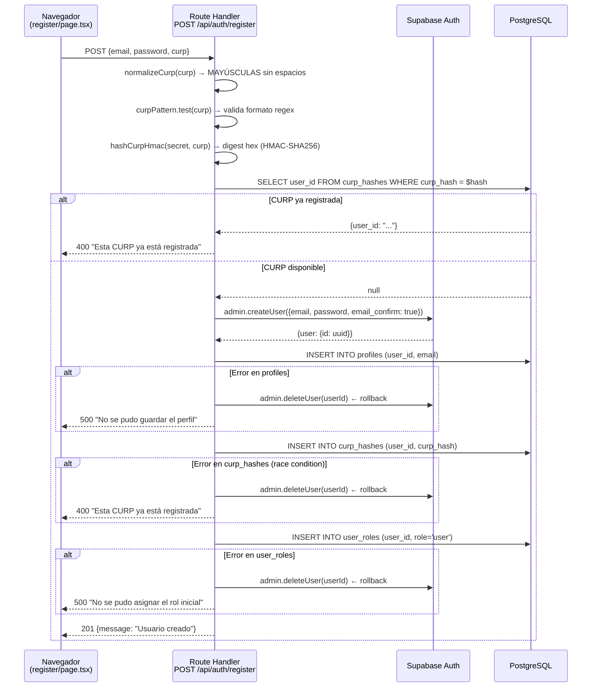
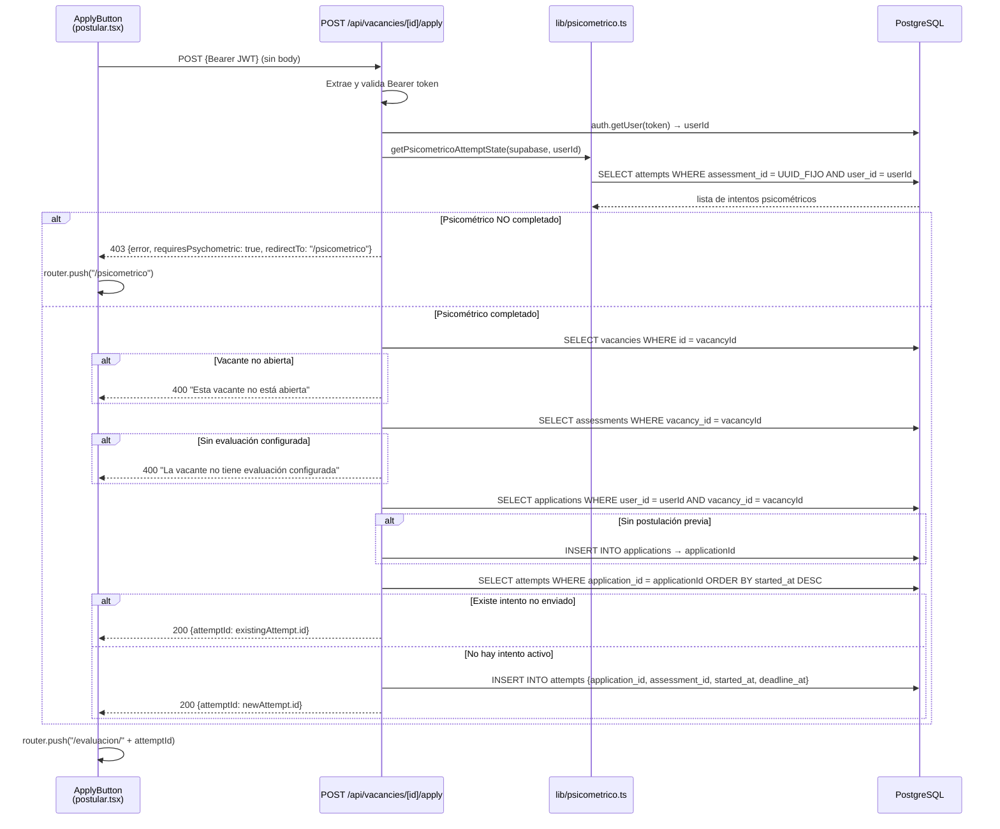
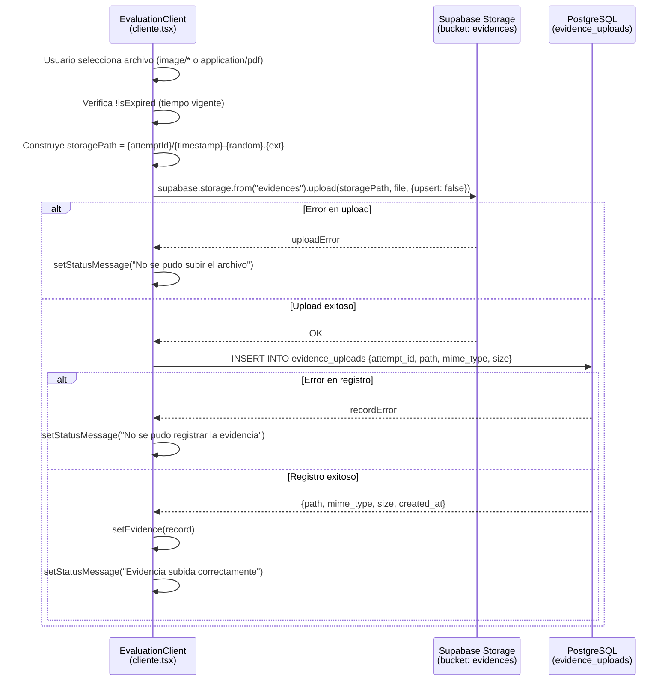
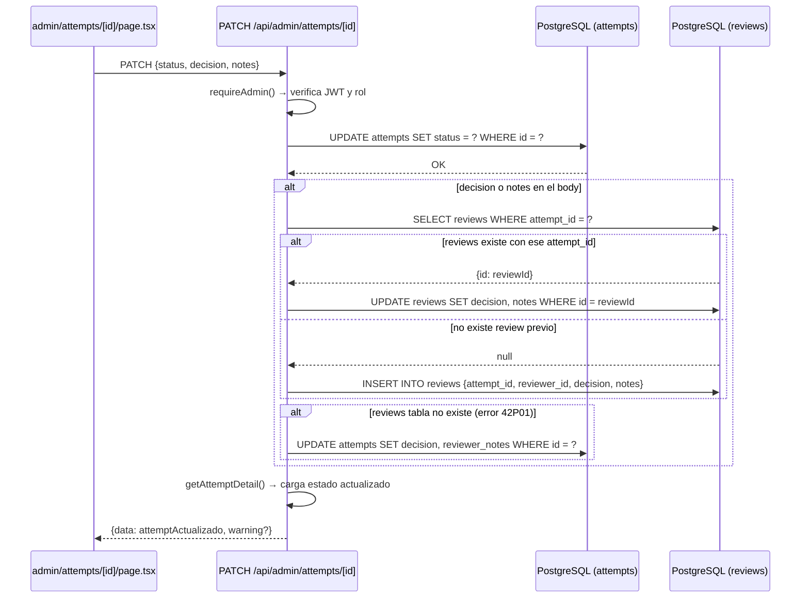

# Capítulo V. Desarrollo e implementación del sistema

---

## 5.1 Organización y arquitectura del software implementado

### 5.1.1 Estructura de directorios

UCES Plataforma de Talento es un monorepo organizado en dos grandes carpetas: `my-app/`, que contiene toda la aplicación Next.js, y `supabase/`, que concentra los artefactos de base de datos. Esta separación refleja la independencia entre la lógica de la aplicación y la definición de la infraestructura de datos.

```
uces-plataforma/
├── my-app/                        ← Aplicación Next.js 16.1.1
│   ├── app/                       ← App Router (rutas, páginas, APIs)
│   │   ├── page.tsx               ← Landing pública
│   │   ├── layout.tsx             ← Layout raíz con estilos globales
│   │   ├── login/page.tsx
│   │   ├── register/page.tsx
│   │   ├── panel/page.tsx
│   │   ├── perfil/page.tsx
│   │   ├── psicometrico/page.tsx
│   │   ├── modulos/[moduleId]/page.tsx
│   │   ├── vacantes/[id]/page.tsx
│   │   ├── vacantes/[id]/postular.tsx
│   │   ├── evaluacion/[attemptId]/
│   │   │   ├── page.tsx           ← Server Component: carga datos
│   │   │   ├── cliente.tsx        ← Client Component: timer e interacción
│   │   │   └── utils.ts           ← Helper formatBytes
│   │   ├── resultado/[attemptId]/page.tsx
│   │   ├── admin/page.tsx
│   │   ├── admin/attempts/[id]/page.tsx
│   │   └── api/                   ← Route Handlers
│   │       ├── auth/register/route.ts
│   │       ├── psicometrico/start/route.ts
│   │       ├── vacancies/[id]/apply/route.ts
│   │       ├── attempts/[id]/answers/route.ts
│   │       ├── attempts/[id]/submit/route.ts
│   │       └── admin/             ← 13 endpoints protegidos con requireAdmin()
│   ├── components/ui/             ← Componentes shadcn/ui (Button, Card, Badge...)
│   └── lib/                       ← Bibliotecas de negocio
│       ├── auth.ts                ← getRoleForSession, resolveRole
│       ├── curp.ts                ← hashCurpHmac, normalizeCurp
│       ├── psicometrico.ts        ← getPsicometricoAttemptState, ensurePsicometricoAttempt
│       ├── psicometricoResults.ts ← calculatePsicometricoSummary
│       ├── reviewDecision.ts      ← ReviewDecision type, isReviewDecision
│       ├── supabaseClient.ts      ← Cliente browser (singleton)
│       └── supabaseServer.ts      ← Cliente servidor (service role)
├── supabase/
│   ├── schema.sql                 ← Definición de las 13 tablas
│   ├── rls.sql                    ← Función get_my_role() y todas las políticas RLS
│   ├── roles.sql                  ← Tabla user_roles con backfill
│   ├── seed.sql                   ← Datos de prueba y cuestionario psicométrico
│   └── migration_*.sql            ← Migraciones incrementales
```

### 5.1.2 Arquitectura implementada

La arquitectura sigue el patrón de tres capas adaptado a la plataforma Next.js/Supabase:

**Figura 5.1 — Diagrama de arquitectura implementada**

### 5.1.3 Componentes principales

| Componente | Tipo | Responsabilidad | Archivo |
|---|---|---|---|
| `EvaluationPage` | Server Component | Carga intento, preguntas y respuestas guardadas desde servidor | `app/evaluacion/[attemptId]/page.tsx` |
| `EvaluationClient` | Client Component | Timer, guardado de respuestas, carga de evidencia, envío | `app/evaluacion/[attemptId]/cliente.tsx` |
| `PanelPage` | Client Component | Sesión, rol, módulos, estado psicométrico | `app/panel/page.tsx` |
| `ApplyButton` | Client Component | Flujo de postulación con manejo de errores y redirección | `app/vacantes/[id]/postular.tsx` |
| `requireAdmin()` | Middleware de API | Validación JWT + verificación de rol admin | `app/api/admin/utils.ts` |
| `supabaseBrowser()` | Singleton | Cliente Supabase para el navegador con clave anónima | `lib/supabaseClient.ts` |
| `supabaseServer()` | Factory | Cliente Supabase con clave de servicio para el servidor | `lib/supabaseServer.ts` |
| `getRoleForSession()` | Función utilitaria | Invoca RPC `get_my_role()` y normaliza el resultado | `lib/auth.ts` |
| `hashCurpHmac()` | Función criptográfica | HMAC-SHA256 de la CURP con clave de entorno | `lib/curp.ts` |
| `calculatePsicometricoSummary()` | Función de cálculo | Score Big Five, clasificación por rasgo | `lib/psicometricoResults.ts` |

### 5.1.4 Diferencia entre la arquitectura propuesta y la implementada

El Trabajo A propuso una arquitectura web en tres capas (presentación, lógica de negocio, datos) sin especificar el framework. La implementación realiza esa separación dentro del modelo de Next.js App Router:

| Capa propuesta (Trabajo A) | Realización en Trabajo B |
|---|---|
| Capa de presentación | Server Components + Client Components en `app/` |
| Capa de lógica de negocio | Route Handlers en `app/api/` + funciones en `lib/` |
| Capa de datos | PostgreSQL en Supabase, accedido vía SDK |
| Control de acceso | RLS en PostgreSQL + `requireAdmin()` en API |

Una diferencia notable es que el Trabajo A contemplaba un servidor de aplicaciones independiente de la base de datos. En la implementación, Next.js y Supabase operan como plataformas separadas: la aplicación se despliega en Vercel y la base de datos en Supabase. La comunicación entre ambas ocurre a través del SDK de Supabase usando las credenciales de servicio almacenadas como variables de entorno del servidor.

---

## 5.2 Configuración e integración de Supabase

### 5.2.1 Dos clientes, dos contextos

La integración con Supabase se divide en dos instancias del cliente con propósitos y niveles de privilegio distintos.

**Cliente de navegador** — `lib/supabaseClient.ts`

```typescript
// lib/supabaseClient.ts
export const supabaseBrowser = () => {
  if (!browserClient) {
    browserClient = createClient(supabaseUrl, supabaseKey);  // anon key
  }
  return browserClient;
};
```

Este cliente usa la clave anónima (`NEXT_PUBLIC_SUPABASE_ANON_KEY`), que es pública e incluida en el bundle de JavaScript enviado al navegador. Las operaciones que realiza están sujetas a las políticas de Row Level Security: solo puede leer o modificar los registros que las políticas permiten al usuario autenticado. Se implementa como singleton para evitar crear múltiples conexiones en re-renders.

**Cliente de servidor** — `lib/supabaseServer.ts`

```typescript
// lib/supabaseServer.ts
export const supabaseServer = () => {
  return createClient(supabaseUrl, serviceRole, {
    auth: { autoRefreshToken: false, persistSession: false }
  });
};
```

Este cliente usa la clave de rol de servicio (`SUPABASE_SERVICE_ROLE_KEY`), que tiene acceso irrestricto a la base de datos y omite las políticas de RLS. Se usa exclusivamente en los Route Handlers del servidor y en los Server Components. Las opciones `autoRefreshToken: false` y `persistSession: false` indican que este cliente no mantiene estado entre solicitudes, lo que es correcto para un entorno sin estado como las funciones de servidor.

### 5.2.2 Variables de entorno y separación de credenciales

| Variable | Prefijo | Accesible en | Propósito |
|---|---|---|---|
| `NEXT_PUBLIC_SUPABASE_URL` | `NEXT_PUBLIC_` | Cliente + Servidor | URL del proyecto Supabase |
| `NEXT_PUBLIC_SUPABASE_ANON_KEY` | `NEXT_PUBLIC_` | Cliente + Servidor | Clave pública para operaciones RLS |
| `SUPABASE_SERVICE_ROLE_KEY` | Sin prefijo | Solo servidor | Clave privilegiada, omite RLS |
| `CURP_HASH_SECRET` | Sin prefijo | Solo servidor | Clave HMAC para protección de CURP |

La convención de Next.js que distingue variables con `NEXT_PUBLIC_` (incluidas en el bundle del cliente) de las que no llevan ese prefijo (solo disponibles en el servidor) es el mecanismo que garantiza que las credenciales privilegiadas no lleguen al navegador.

La Figura 5.23 ilustra la estructura relacional completa del sistema mediante el visualizador de esquema de Supabase Studio, confirmando las 13 tablas del modelo de datos y sus relaciones de clave foránea tal como se definen en `supabase/schema.sql`.

---

## 5.3 Implementación del registro y autenticación

### 5.3.1 Flujo de registro (RF-01, RF-02)

El registro de candidatos es la operación de mayor complejidad transaccional del sistema. El Route Handler `POST /api/auth/register` coordina cuatro operaciones sobre tres tablas diferentes y el servicio de autenticación, con reversión automática si cualquier paso falla.

**Figura 5.2 — Diagrama de secuencia del registro de candidato**



**Análisis de las validaciones del registro:**

El Route Handler ejecuta dos tipos de validaciones antes de crear el usuario:

1. **Validación de formato de CURP:** La expresión regular `/^[A-Z]{4}\d{6}[HM][A-Z]{5}[A-Z0-9]\d$/` verifica la estructura formal de 18 caracteres. Esta validación ocurre después de normalizar la CURP a mayúsculas mediante `normalizeCurp()`, lo que garantiza que "garca800101hdfrrr01" y "GARCA800101HDFRRR01" sean tratados como equivalentes.

2. **Verificación de duplicado mediante HMAC:** El hash HMAC-SHA256 se calcula antes de cualquier operación de base de datos. La consulta sobre `curp_hashes` verifica si ya existe ese hash. Este orden es deliberado: consultar antes de crear evita crear el usuario y luego descubrir que la CURP estaba registrada.

**Patrón de rollback transaccional:**

PostgreSQL soporta transacciones nativas (`BEGIN / COMMIT / ROLLBACK`), pero el SDK de Supabase no expone una API de transacciones multitabla en JavaScript. El código resuelve esto de forma manual: cada paso verifica si ocurrió un error y, de ser así, invoca `supabase.auth.admin.deleteUser(userId)` para revertir la creación del usuario en Supabase Auth antes de retornar el error al cliente. Esto garantiza que no queden usuarios huérfanos en el sistema de autenticación cuando la creación de registros dependientes falla.

La opción `email_confirm: true` en `admin.createUser()` indica que la cuenta se crea ya confirmada, sin requerir que el usuario haga clic en un enlace de verificación. Esta decisión refleja el contexto de uso controlado del sistema, donde los candidatos son invitados a registrarse dentro de un proceso institucional.

### 5.3.2 Autenticación y resolución de rol (RF-03)

El inicio de sesión utiliza el método estándar de Supabase Auth:

```typescript
// Dentro de app/login/page.tsx (Client Component)
const { error } = await supabase.auth.signInWithPassword({ email, password });
if (!error) router.push("/panel");
```

Una vez iniciada la sesión, el token JWT emitido por Supabase Auth queda almacenado en el almacenamiento local del navegador. Los componentes cliente acceden a él mediante `supabase.auth.getSession()`.

La resolución del rol del usuario ocurre en `lib/auth.ts`:

```typescript
// lib/auth.ts
export const getRoleForSession = async (supabase: SupabaseClient): Promise<ProfileRole> => {
  const { data, error } = await supabase.rpc("get_my_role");
  if (error) return "user";  // Fallback seguro ante cualquier error
  return resolveRole(typeof data === "string" ? data : null);
};
```

Esta función invoca el RPC `get_my_role()` definido en la base de datos. El RPC, a su vez, consulta primero `user_roles` para el usuario autenticado (`auth.uid()`), y luego cae a `profiles.role` si no encuentra entrada. La función `resolveRole()` aplica la sanitización final: solo acepta los valores literales `"admin"` o `"user"`, retornando `"user"` ante cualquier otro valor. Este triple nivel de defensa (RPC → resolveRole → fallback en error de RPC) garantiza que un valor inesperado en la base de datos no conceda privilegios elevados accidentalmente.

---

## 5.4 Desarrollo del panel del candidato

### 5.4.1 Arquitectura del panel (RF-04)

El panel del candidato (`app/panel/page.tsx`) es un Client Component. Esta decisión se justifica por la naturaleza dinámica de sus datos: la sesión del usuario, el perfil, la lista de módulos, el rol y el estado del psicométrico solo se conocen en tiempo de ejecución en el navegador. Generarlos en el servidor requeriría acceso a la sesión del cliente, lo que complica el modelo de Server Components.

El panel carga sus datos mediante cinco efectos independientes que se ejecutan en secuencia condicionada:

```
Efecto 1: getSession() → Si no hay sesión → redirige a /login
          Si hay sesión → setSession(data.session)
               ↓
Efecto 2: (depende de session) → carga perfil desde profiles
               ↓
Efecto 3: (depende de session) → getRoleForSession() → setUserRole
               ↓
Efecto 4: (depende de session) → carga módulos desde modules
               ↓
Efecto 5: (depende de session) → verifica estado del psicométrico
```

Este patrón de efectos condicionados garantiza que ninguna consulta de datos se ejecute sin una sesión válida. La protección de ruta es del lado del cliente: si la sesión no existe, se redirige inmediatamente a `/login`.

### 5.4.2 Comportamiento adaptado al rol

Una vez que el rol se resuelve, la interfaz adapta su contenido:

```typescript
// app/panel/page.tsx
const isAdmin = userRole === "admin";
// ...
{isAdmin ? (
  <Button asChild>
    <Link href="/admin">Panel administrativo</Link>
  </Button>
) : null}
```

El botón de acceso al panel administrativo solo se renderiza cuando `userRole === "admin"`. Esta verificación del lado del cliente es un mecanismo de usabilidad, no de seguridad: los endpoints de API del área administrativa están protegidos de forma independiente mediante `requireAdmin()`, de modo que incluso si un usuario modificara el HTML del cliente, los Route Handlers rechazarían sus solicitudes.

### 5.4.3 Indicador de estado psicométrico

El panel verifica el estado del cuestionario base consultando directamente la tabla `attempts` con el UUID fijo del psicométrico (`PSICOMETRICO_BASE_ASSESSMENT_ID = "f2000000-0000-0000-0000-000000000001"`):

```typescript
// app/panel/page.tsx
const hasCompleted = attempts.some((attempt) =>
  Boolean(attempt.submitted_at) || completedStatuses.has(attempt.status ?? "")
);
setPsicometricoReady(hasCompleted);
```

Esta verificación muestra al candidato si puede postularse a vacantes o si primero debe completar el cuestionario psicométrico, sin necesidad de hacer una solicitud adicional a una API: se ejecuta directamente contra Supabase desde el navegador, aprovechando que el cliente anónimo con las políticas de RLS permite al usuario consultar sus propios intentos.

---

## 5.5 Gestión y consulta de vacantes

### 5.5.1 Jerarquía módulos → vacantes (RF-04, RF-05)

Las vacantes del sistema se organizan en una jerarquía de dos niveles: un módulo (área funcional) agrupa múltiples vacantes. El candidato navega primero a la lista de módulos en el panel, luego elige un módulo para ver sus vacantes, y finalmente accede al detalle de una vacante específica.

> **Nota de diseño arquitectónico:** La plataforma no implementa una ruta de listado general de vacantes (`/vacantes`). El acceso se realiza exclusivamente mediante la URL directa `/vacantes/[id]` desde el módulo correspondiente. Esta decisión elimina una capa de indirección innecesaria en el flujo de postulación y simplifica la arquitectura del servidor al evitar paginación y filtrado global de vacantes, que quedó fuera del alcance del MVP.

| Ruta | Componente | Datos que carga |
|---|---|---|
| `/panel` | Client Component | Módulos: `id, name, description` |
| `/modulos/[moduleId]` | Server Component | Módulos con vacantes anidadas: `vacancies(id, title, status, schedule, location)` |
| `/vacantes/[id]` | Server Component | Detalle de vacante: descripción, requisitos, assessment asociado |

Las páginas `/modulos/[moduleId]` y `/vacantes/[id]` son Server Components que realizan sus consultas directamente en el servidor, sin exponer las credenciales al navegador:

```typescript
// app/modulos/[moduleId]/page.tsx (simplificado)
const supabase = supabaseServer();
const { data: module } = await supabase
  .from("modules")
  .select("id, name, description, vacancies(id, title, status, schedule, location)")
  .eq("id", moduleId)
  .maybeSingle();
```

### 5.5.2 Estados de vacante y disponibilidad

Las vacantes tienen tres estados posibles definidos en la base de datos: `open`, `closed` y `draft`. Solo las vacantes con estado `open` son accesibles para postulación. El componente de la página de vacante verifica el estado antes de mostrar el botón de postulación:

```typescript
// app/vacantes/[id]/page.tsx
const isOpen = vacancy.status === "open";
// ...
<ApplyButton vacancyId={vacancy.id} disabled={!isOpen} />
```

La verificación del lado del servidor ocurre adicionalmente en el Route Handler de postulación (sección 5.6), que rechaza cualquier intento de postulación a una vacante no abierta.

---

## 5.6 Implementación del proceso de postulación

### 5.6.1 Flujo completo del endpoint de postulación (RF-06, RF-07)

El Route Handler `POST /api/vacancies/[id]/apply` implementa la secuencia de verificaciones más elaborada del flujo del candidato. El handler ejecuta seis pasos en orden secuencial, donde cada paso puede detener el proceso con un error descriptivo.

**Figura 5.3 — Diagrama de secuencia de la postulación**



**Paso 1 — Autenticación del token:**
El endpoint extrae el JWT del encabezado `Authorization`, lo valida mediante `supabase.auth.getUser(token)` y extrae el `userId`. Si el token es inválido o expiró, devuelve 401.

**Paso 2 — Verificación del psicométrico:**
La función `getPsicometricoAttemptState()` consulta todos los intentos del usuario para el assessment con UUID fijo `f2000000-0000-0000-0000-000000000001`. Determina si existe al menos uno con `submitted_at` no nulo o con estado en el conjunto `{SUBMITTED, UNDER_REVIEW, COMPLETED}`.

Punto importante: la verificación comprueba únicamente que el psicométrico esté **completado** (enviado), no que el candidato haya obtenido un resultado favorable en ningún rasgo. Esta diferencia respecto a lo que podría esperarse del diseño es la discrepancia D-01 documentada en el Trabajo B. Su justificación de implementación es que el sistema no tiene una regla de negocio formalizada sobre qué puntaje constituye un umbral de exclusión; los umbrales son orientativos para el administrador, no bloqueos automatizados.

**Paso 3 — Verificación del estado de la vacante:**
La consulta a `vacancies` verifica `vacancy.status === "open"`. Esta verificación ocurre en el servidor, independientemente de lo que muestre la interfaz.

**Paso 4 — Verificación del assessment:**
La consulta a `assessments` verifica que la vacante tiene un assessment asociado con un `assessment_id` válido. El sistema no puede crear un intento sin un assessment de referencia.

**Paso 5 — Creación o recuperación de postulación:**
El handler consulta si ya existe una `application` para el par `(user_id, vacancy_id)`. Si existe, reutiliza su `id`; si no, la crea. Esto implementa la regla RN-05: no crear postulaciones duplicadas.

**Paso 6 — Creación o recuperación del intento:**
Si existe un intento asociado a la aplicación que aún no fue enviado (`!existingAttempt.submitted_at`), el handler devuelve su ID directamente sin crear un nuevo intento. Esto permite que un candidato que cerró el navegador pueda retomar su evaluación. Si no hay intento activo, se crea uno nuevo calculando `deadline_at = started_at + (duration_minutes * 60000)`.

**Lado del cliente — `ApplyButton`:**

```typescript
// app/vacantes/[id]/postular.tsx
const response = await fetch(`/api/vacancies/${vacancyId}/apply`, {
  method: "POST",
  headers: { Authorization: `Bearer ${token}` },
});
const payload = await response.json();

if (!response.ok) {
  if (payload.requiresPsychometric) {
    router.push(payload.redirectTo ?? "/psicometrico");
  } else {
    setError(payload.error ?? "No se pudo completar la postulación");
  }
  return;
}
router.push(`/evaluacion/${payload.attemptId}`);
```

El `ApplyButton` maneja dos tipos de error diferenciados: si la respuesta incluye `requiresPsychometric: true`, redirige al candidato a completar el cuestionario base; de lo contrario, muestra el mensaje de error en la interfaz.

---

## 5.7 Desarrollo del módulo de evaluaciones

### 5.7.1 División Server Component / Client Component

La ruta `/evaluacion/[attemptId]` implementa la separación más clara del sistema entre carga de datos (servidor) e interacción (cliente). Este diseño tiene una justificación técnica precisa: las preguntas de la evaluación deben cargarse en el servidor para garantizar que el usuario recibe el contenido correcto antes de que el temporizador comience a correr en el cliente.

**`page.tsx` — Server Component:** Carga en paralelo el intento con sus preguntas, las respuestas guardadas previamente, y las evidencias existentes mediante `Promise.all`. Construye el `answersMap` (mapa de `question_id → selected_option`) para inicializar el estado del cliente con las respuestas ya guardadas en sesiones anteriores. Pasa todos estos datos como props al `EvaluationClient`.

**`cliente.tsx` — Client Component:** Gestiona el estado local de la evaluación: respuestas en memoria (`useState`), cuenta regresiva del temporizador (`setRemainingMs`), estado de subida de evidencia, y estado de envío.

La inicialización del estado del temporizador es inmediata:

```typescript
// app/evaluacion/[attemptId]/cliente.tsx
const [remainingMs, setRemainingMs] = useState(() =>
  new Date(deadlineAt).getTime() - Date.now()
);
```

Al calcular `remainingMs` en la inicialización del estado (no en un efecto), el temporizador refleja desde el primer render el tiempo real restante, basado en el `deadline_at` que provino del servidor.

### 5.7.2 Mecanismo del temporizador

El temporizador se implementa con `setInterval` en un efecto de React:

```typescript
// app/evaluacion/[attemptId]/cliente.tsx (fragmento del useEffect del timer)
const interval = setInterval(() => {
  const nextRemainingMs = new Date(deadlineAt).getTime() - Date.now();
  setRemainingMs(nextRemainingMs);

  if (nextRemainingMs <= 0 && token && !submittedAt && !autoSubmitTriggeredRef.current) {
    autoSubmitTriggeredRef.current = true;  // Previene doble envío
    void handleSubmitAttempt(true);
  }
}, 1000);
```

El intervalo recalcula `nextRemainingMs` en cada tick usando la fecha absoluta `deadlineAt` (proveniente del servidor), no una cuenta regresiva relativa. Esto previene que pequeñas desviaciones en la ejecución del intervalo acumulen errores a lo largo del tiempo. La referencia `autoSubmitTriggeredRef` es un mecanismo anti-duplicado: el envío automático solo se activa una vez, aunque el intervalo siga corriendo brevemente después.

La pantalla del candidato muestra el tiempo en formato `MM:SS` con el badge cambiando a variante `destructive` (rojo) cuando el tiempo se agota. Los botones de selección de respuesta y carga de evidencia se deshabilitan cuando `isExpired === true`:

```typescript
<button
  disabled={isExpired || savingQuestion === question.id}
  onClick={() => handleSelect(question.id, optionKey)}
>
```

**Distinción cliente/servidor en el control de tiempo:**
La interfaz deshabilita visualmente las respuestas cuando el tiempo expira. Sin embargo, la verificación definitiva ocurre en el servidor: el Route Handler de respuestas (`answers/route.ts`) verifica `Date.now() > new Date(attempt.deadline_at).getTime()` antes de procesar cada guardado. Esto garantiza que incluso si el candidato manipulara el cliente para saltar la restricción visual, el servidor rechazaría las respuestas tardías.

### 5.7.3 Guardado individual de respuestas (RF-08, RF-09)

Cada vez que el candidato selecciona una opción, el evento llama a `handleSelect`, que actualiza el estado local inmediatamente y luego invoca `saveAnswer` de forma asíncrona:

```typescript
const handleSelect = (questionId: string, optionKey: string) => {
  setAnswers((prev) => ({ ...prev, [questionId]: optionKey }));  // UI instantánea
  void saveAnswer(questionId, optionKey);                         // Guardado asíncrono
};
```

La actualización del estado local es inmediata, lo que da retroalimentación visual instantánea al candidato sin esperar la confirmación del servidor. El Route Handler `POST /api/attempts/[attemptId]/answers` realiza un `UPSERT` sobre la tabla `answers`:

```typescript
// app/api/attempts/[attemptId]/answers/route.ts
// Validaciones previas al upsert:
// 1. JWT válido → userId
// 2. attempt.application.user_id === userId (pertenencia)
// 3. !attempt.submitted_at (no enviado aún)
// 4. Date.now() <= deadline_at (tiempo vigente)
// 5. question.assessment_id === attempt.assessment_id (pregunta pertenece a la evaluación)

await supabase.from("answers").upsert({
  attempt_id: attemptId,
  question_id: body.questionId,
  selected_option: body.selectedOption,
});
```

La restricción `UNIQUE (attempt_id, question_id)` en la tabla `answers` garantiza que el UPSERT actualice la respuesta existente en lugar de crear un duplicado. La validación de que la pregunta pertenece al assessment del intento previene que un candidato intente guardar respuestas de otro cuestionario en un intento que no le corresponde.

### 5.7.4 Estados del intento

La columna `status` en la tabla `attempts` sigue el ciclo definido en el esquema:

| Estado | Significado | Quién lo establece |
|---|---|---|
| `IN_PROGRESS` | Intento en curso (valor por defecto) | Creación del registro |
| `SUBMITTED` | Enviado por el candidato, pendiente de revisión | `submit/route.ts` → `UNDER_REVIEW` |
| `UNDER_REVIEW` | En revisión por el administrador | `submit/route.ts` al enviar |
| `COMPLETED` | Revisión terminada con decisión final | Panel admin al aprobar o rechazar |

### 5.7.5 Envío del intento (RF-11)

El Route Handler `POST /api/attempts/[attemptId]/submit` (analizado en profundidad en el Capítulo III, sección 3.7) realiza tres operaciones al recibir el envío:

1. Verifica que el intento no fue enviado previamente (`!attempt.submitted_at`).
2. Calcula el resumen psicométrico y el `theory_score` a partir de las respuestas guardadas.
3. Actualiza el registro del intento con `submitted_at`, `status = UNDER_REVIEW`, `theory_score` y `psychometric_summary`.

El `theory_score` se calcula mediante la función `calculatePsicometricoSummary()` para cualquier tipo de intento, tanto psicométrico como de conocimientos. La función acumula respuestas únicamente para preguntas cuyo `prompt` comienza con el prefijo `MINI_BIG_FIVE`; el divisor `likertQuestions` está codificado en 20. Para el cuestionario psicométrico, esto produce un valor entre 0 y 100 que representa el porcentaje de los 20 reactivos que el candidato respondió (p. ej., si respondió los 20, `theory_score = 100`).

Para evaluaciones de conocimientos, cuyas preguntas no tienen el prefijo `MINI_BIG_FIVE`, el acumulador `likertAnswered` resulta siempre 0 y, en consecuencia, `theory_score` queda registrado como `0`. No existe en el endpoint ninguna ruta de cálculo alternativa que evalúe respuestas correctas comparando `selected_option` con `correct_option`; ese campo no refleja la exactitud de respuestas en evaluaciones de conocimientos. Esta es una **limitación funcional del MVP**: el puntaje de aciertos en evaluaciones de conocimientos no se calcula automáticamente en el momento del envío y deberá incorporarse en una iteración futura.

---

## 5.8 Implementación de las evidencias prácticas

### 5.8.1 Flujo de carga de evidencia (RF-10)

La carga de evidencias ocurre directamente desde el navegador al bucket `evidences` de Supabase Storage, utilizando el cliente anónimo autenticado con el JWT del candidato. No pasa por el servidor Next.js, lo que evita consumir la memoria del servidor para transferencias de archivos.

**Figura 5.4 — Flujo de almacenamiento de evidencias**



### 5.8.2 Generación del path de almacenamiento

```typescript
// app/evaluacion/[attemptId]/cliente.tsx
const extension = file.name.split(".").pop();
const storagePath = `${attemptId}/${Date.now()}-${Math.random().toString(36).slice(2)}${extension ? `.${extension}` : ""}`;
```

El path del archivo combina tres elementos: el `attemptId` como prefijo de carpeta (lo que organiza todos los archivos de un mismo intento juntos), el timestamp en milisegundos (que garantiza orden temporal), y una cadena aleatoria en base 36 (que previene colisiones si dos archivos se suben en el mismo milisegundo). Esta estructura evita que archivos de intentos diferentes compartan rutas.

### 5.8.3 Tipo de archivo y validación

El elemento de entrada de archivo acepta imágenes y PDFs mediante el atributo HTML:

```html
<input type="file" accept="image/*,application/pdf" />
```

Esta restricción opera en el navegador y puede ser omitida por un usuario técnico que modifique el DOM. No existe validación adicional del tipo MIME en el Route Handler de evidencias porque la carga ocurre directamente a Supabase Storage, no a través de un endpoint propio. El tipo MIME reportado por el navegador se almacena como `file.type` en el campo `mime_type` de `evidence_uploads`.

La política de RLS en el bucket `evidences` restringe la subida a usuarios autenticados que sean propietarios del archivo (`owner = auth.uid()`), lo que previene que un candidato suba archivos al espacio de otro. Sin embargo, no valida el tipo de contenido del archivo binario; esta es una limitación documentada del MVP.

### 5.8.4 Tabla evidence_uploads

| Columna | Tipo | Descripción |
|---|---|---|
| `id` | uuid | Identificador del registro |
| `attempt_id` | uuid → attempts | Intento al que pertenece la evidencia |
| `bucket` | text | Nombre del bucket (`evidences` por defecto) |
| `path` | text | Ruta dentro del bucket para construir la URL |
| `mime_type` | text | Tipo MIME declarado por el navegador |
| `size` | integer | Tamaño en bytes |
| `created_at` | timestamptz | Momento del registro |

El campo `path` es el dato primario para acceder al archivo: permite al administrador generar una URL firmada temporal mediante la API de Supabase Storage. En el cliente de la evaluación, se usa `supabase.storage.from("evidences").getPublicUrl(evidence.path)` para mostrar un enlace al archivo durante la evaluación activa, aunque el bucket es privado y la URL pública solo funciona durante la sesión autenticada del propietario.

### 5.8.5 Integración con el panel administrativo

El panel administrativo recupera las evidencias de un intento y genera URLs firmadas con vigencia de 60 minutos para que el administrador pueda acceder a ellas:

```typescript
// app/api/admin/attempts/[id]/detail/route.ts (fragmento)
const { data: signedUrl } = await supabase.storage
  .from("evidences")
  .createSignedUrl(upload.path, 3600);  // 3600 segundos = 60 minutos
```

Las URLs firmadas son la forma correcta de acceder a archivos en un bucket privado: contienen una firma criptográfica que caduca en el tiempo especificado. El administrador puede abrir el archivo durante ese período; al expirar, necesitaría solicitar una nueva URL.

---

## 5.9 Implementación del panel administrativo

### 5.9.1 Arquitectura del panel y autenticación del administrador (RF-13 a RF-18)

El panel administrativo se implementa en dos páginas: `app/admin/page.tsx`, que concentra las operaciones de configuración y consulta general, y `app/admin/attempts/[id]/page.tsx`, que gestiona la revisión individual de cada intento. Ambas son Client Components que ejecutan la misma secuencia de verificación al montarse:

```typescript
// app/admin/page.tsx — verificación inicial
supabase.auth.getSession().then(async ({ data }) => {
  if (!data.session) { router.replace("/login"); return; }
  const role = await getRoleForSession(supabase);
  if (role !== "admin") { router.replace("/panel"); return; }
  setToken(data.session.access_token);
  setLoading(false);
});
```

La doble verificación —sesión activa y rol admin— garantiza que solo los administradores accedan a la interfaz. El token de acceso se almacena en el estado local del componente y se inyecta en cada solicitud a los endpoints administrativos como encabezado `Authorization: Bearer {token}`. Para esto se define un helper interno:

```typescript
// app/admin/page.tsx — helper de petición autenticada
const callAdmin = async <T,>(path: string, init?: RequestInit): Promise<T> => {
  if (!token) throw new Error("Sin sesión");
  const response = await fetch(path, {
    ...init,
    headers: { "Content-Type": "application/json", authorization: `Bearer ${token}`, ...(init?.headers ?? {}) },
  });
  const json = (await response.json().catch(() => ({}))) as T & { error?: string };
  if (!response.ok) throw new Error(json.error ?? "Error inesperado");
  return json;
};
```

Este helper centraliza el manejo del token y el lanzamiento de errores, reduciendo la duplicación en las llamadas individuales a cada endpoint.

### 5.9.2 Estructura de navegación por pestañas

El panel organiza sus funciones en cinco pestañas: `resumen`, `modulos`, `vacantes`, `evaluaciones` e `intentos`. La navegación entre ellas no implica cambios de ruta: el estado `activeTab` determina qué sección se renderiza dentro del mismo componente.

| Pestaña | Función principal | Endpoints consumidos |
|---|---|---|
| Resumen | Contadores globales y últimos 5 intentos | Todos (carga paralela) |
| Módulos | CRUD de módulos | `GET/POST /api/admin/modules`, `PATCH /api/admin/modules/[id]` |
| Vacantes | CRUD de vacantes con filtro | `GET/POST /api/admin/vacancies`, `PATCH/DELETE /api/admin/vacancies/[id]` |
| Evaluaciones | Edición de evaluaciones y CRUD de preguntas | `PATCH /api/admin/assessments/[id]`, `GET/POST /api/admin/assessments/[id]/questions`, `PATCH/DELETE /api/admin/questions/[id]` |
| Intentos | Lista filtrable de intentos con acceso al detalle | `GET /api/admin/attempts`, `→ /admin/attempts/[id]` |

Al inicializarse el panel, se cargan los cuatro conjuntos de datos en paralelo mediante `Promise.all([loadModules(), loadVacancies(), loadAssessments(), loadAttempts()])`. Esta carga en paralelo reduce el tiempo de espera inicial al eliminar la dependencia secuencial entre las cuatro solicitudes.

### 5.9.3 Gestión de módulos (RF-13)

Los módulos son las unidades organizativas que agrupan vacantes. El endpoint `GET /api/admin/modules` acepta un parámetro de búsqueda opcional `?search=` que aplica un filtro `ILIKE` sobre el nombre. La creación y edición se realizan con un formulario único: cuando el campo `id` del formulario está vacío, se ejecuta `POST`; cuando contiene el ID de un módulo existente, se ejecuta `PATCH`.

La implementación del endpoint POST incluye un mecanismo de tolerancia para la columna `sort_order`: si el intento de inserción con esa columna produce un error de columna inexistente, se reintenta la inserción sin ella. Este patrón de compatibilidad descendente se repite en varios endpoints del sistema para manejar diferencias entre esquemas de desarrollo y producción.

### 5.9.4 Gestión de vacantes (RF-14)

El proceso de creación de una vacante involucra dos operaciones coordinadas en el servidor: primero se crea el registro en `vacancies` y, si la inserción es exitosa, se crea automáticamente una evaluación base asociada en `assessments`:

```typescript
// app/api/admin/vacancies/route.ts — POST handler
const vacancyResponse = await admin.supabase.from("vacancies").insert(payload).select("*").single();
// ...
const assessmentResponse = await admin.supabase.from("assessments").insert({
  vacancy_id: vacancyResponse.data.id,
  title: `Evaluación - ${vacancyResponse.data.title}`,
  duration_minutes: 30,
}).select("*").single();

if (assessmentResponse.error) {
  await admin.supabase.from("vacancies").delete().eq("id", vacancyResponse.data.id);
  return NextResponse.json({ error: "No se pudo crear la evaluación automática" }, { status: 400 });
}
```

Este diseño garantiza que toda vacante tenga una evaluación desde el momento de su creación, eliminando la posibilidad de que un candidato intente postularse a una vacante sin assessment configurado. Si la creación del assessment falla, la vacante se elimina mediante rollback manual.

Los estados de vacante disponibles son `open`, `closed` y `draft`. El estado por defecto al crear es `open`. La interfaz ofrece un botón dedicado para cerrar directamente una vacante sin abrir el formulario de edición. La vacante marcada como `draft` no aparece en el catálogo visible para los candidatos.

### 5.9.5 Configuración de evaluaciones y preguntas (RF-15, RF-16)

La edición de una evaluación se limita al título y la duración en minutos mediante `PATCH /api/admin/assessments/[id]`. La duración determina el tiempo que tendrá el candidato desde que inicia el intento.

Las preguntas se crean desde la vista de evaluaciones con tres campos: el texto de la pregunta (`prompt`), las opciones de respuesta (ingresadas como texto separado por comas o saltos de línea y convertidas a arreglo JSON), y la opción correcta (`correct_option`). Las opciones se normalizan en el cliente mediante:

```typescript
const parseOptionsInput = (text: string): string[] =>
  text.split(/[\n,]/).map((option) => option.trim()).filter(Boolean);
```

Esta normalización acepta tanto listas separadas por coma como entradas en múltiples renglones, reduciendo la fricción para el administrador al ingresar las opciones.

Cuando se muestra una pregunta existente, la función `normalizeOptions()` convierte el valor almacenado en la base de datos —que puede ser un arreglo JSON, una cadena JSON o un objeto— al formato de arreglo esperado por la interfaz. Esta normalización defensiva maneja distintos formatos que pueden haberse generado durante el desarrollo.

Las preguntas del cuestionario psicométrico tienen un formato especial de prompt que las identifica ante el sistema de cálculo: `MINI_BIG_FIVE | [RASGO] | [texto de la pregunta]`. Este prefijo no es visible para el candidato durante la evaluación, pero es el mecanismo mediante el cual la función `calculatePsicometricoSummary()` agrupa las respuestas por rasgo.

### 5.9.6 Consulta de postulaciones e intentos (RF-17)

La pestaña de intentos muestra todos los registros de la tabla `attempts` con información del candidato y la vacante mediante una consulta con relaciones anidadas:

```typescript
// app/api/admin/attempts/route.ts
admin.supabase.from("attempts")
  .select("id, status, started_at, submitted_at, theory_score, application:applications!inner(id, user_id, vacancy_id, vacancy:vacancies(title), profile:profiles!applications_user_id_fkey(name, email))")
  .order("started_at", { ascending: false })
```

Esta consulta usa el join `!inner` para garantizar que solo se devuelvan intentos que tengan una postulación asociada. El panel ofrece filtros por `vacancy_id`, `user_id` y `status` que el administrador puede combinar para reducir la lista.

La Figura 5.22 muestra el estado de la tabla `applications` en el entorno de demostración del sistema, con postulaciones pobladas en distintos estados operativos, evidenciando la correcta persistencia de la capa de datos.

### 5.9.7 Detalle de intento y consulta de respuestas y evidencias (RF-17)

La página de detalle de intento (`/admin/attempts/[id]`) es la vista más completa del panel. Muestra en secciones diferenciadas:

1. **Datos generales:** email y nombre del candidato, vacante, módulo, estado actual y decisión.
2. **Resumen psicométrico:** cuando el intento corresponde al cuestionario base, muestra los scores por rasgo, su clasificación y las respuestas individuales.
3. **Acciones de revisión:** selector de decisión (`APPROVED` / `REJECTED`), campo de notas y botones para cambiar el estado del intento.
4. **Respuestas:** lista de todas las respuestas con el texto de la pregunta, la opción seleccionada y la opción correcta.
5. **Evidencias:** archivos subidos con nombre de ruta, tipo MIME, tamaño y enlace de descarga.

Los archivos de evidencia se muestran con URLs firmadas de 60 minutos generadas por el endpoint `GET /api/admin/attempts/[id]/detail`. Estas URLs se generan mediante `supabase.storage.from(bucket).createSignedUrl(path, 60 * 60)`.

### 5.9.8 Registro de decisiones y observaciones (RF-18)

La operación de registrar una decisión sobre un intento es la más compleja del panel administrativo. El endpoint `PATCH /api/admin/attempts/[id]` implementa una lógica en dos capas para persitir tanto el cambio de estado del intento como la decisión y las notas del revisor.

**Figura 5.5 — Diagrama del flujo de persistencia de decisiones**



La función `persistDecisionAndNotes` intenta primero escribir en `reviews` mediante `upsertReview`. Si la tabla `reviews` no existe (código de error PostgreSQL `42P01` o código PostgREST `PGRST205`), el sistema recae sobre `attempts.decision` y `attempts.reviewer_notes`. En el entorno de producción con el esquema completo, la tabla `reviews` es el almacén primario de decisiones; el fallback hacia `attempts` solo opera cuando el esquema está incompleto.

### 5.9.9 Indicadores de resumen

La pestaña de resumen del panel muestra cuatro contadores calculados en el cliente a partir de los datos ya cargados: número de módulos, vacantes, evaluaciones e intentos. Adicionalmente calcula `reviewAttempts` (intentos con estado `UNDER_REVIEW` o `SUBMITTED`) y `completedAttempts` (estado `COMPLETED`).

Existe un endpoint de estadísticas por vacante en `GET /api/admin/vacancies/[id]/stats` que devuelve `applicationsCount` y `attemptsCount` mediante consultas paralelas. Este endpoint no se consume desde ninguna vista del panel en el estado actual del MVP; fue desarrollado como infraestructura preparatoria para un panel de estadísticas futuro (discrepancia D-03, documentada en la sección 5.12).

---

## 5.10 Implementación de seguridad y control de acceso

### 5.10.1 Autenticación mediante Supabase Auth

La autenticación del sistema se delega íntegramente a Supabase Auth, que implementa el estándar JWT (RFC 7519). Cuando un usuario inicia sesión mediante `signInWithPassword`, Supabase emite un token JWT firmado con RS256 que encapsula el identificador del usuario (`sub`), su correo y metadatos de la sesión. Este token se almacena en el almacenamiento local del navegador y tiene vigencia de una hora por defecto.

La comunicación entre el servidor Next.js y Supabase Auth utiliza la clave de rol de servicio (`SUPABASE_SERVICE_ROLE_KEY`), que permite invocar `supabase.auth.getUser(token)` para validar el JWT sin necesidad de una sesión activa del servidor. Esta validación descifra y verifica la firma del token, devuelve el usuario si el token es válido, y retorna un error si el token está expirado, malformado o revocado.

La Figura 5.24 muestra el panel de gestión de usuarios de Supabase Auth en el entorno de demostración, evidenciando que cada candidato y administrador posee una identidad única gestionada por el servicio externo. Los registros corresponden a usuarios de prueba creados mediante la Auth Admin API, con verificación de correo electrónico activada de forma programática.

### 5.10.2 Función `requireAdmin()` y protección de operaciones administrativas

La función `requireAdmin()` es el guardián de acceso para los 13 endpoints del área administrativa. Su implementación en `app/api/admin/utils.ts` ejecuta cuatro verificaciones en secuencia:

**Figura 5.6 — Flujo de autorización en requireAdmin()**

```mermaid
flowchart TD
    A[Route Handler recibe Request] --> B{Authorization header\ncomienza con Bearer?}
    B -- No --> C[401 No autenticado]
    B -- Sí --> D[Extrae token JWT]
    D --> E[supabase.auth.getUser(token)]
    E --> F{JWT válido y\nusuario existe?}
    F -- No --> G[401 Sesión inválida]
    F -- Sí --> H[Crea supabaseAsUser con\nanonKey + header Bearer]
    H --> I[supabaseAsUser.rpc('get_my_role')]
    I --> J{roleData === 'admin'?}
    J -- No --> K[403 Acceso restringido]
    J -- Sí --> L[Retorna {supabase: serviceClient, userId}]
```

El diseño de `requireAdmin()` tiene una característica notable: para verificar el rol, crea un cliente Supabase que usa la clave anónima (`anonKey`) pero inyecta el JWT del usuario en el encabezado `Authorization`. Esto hace que la llamada `rpc("get_my_role")` se ejecute en el contexto de seguridad del usuario, activando las políticas de RLS que solo permiten a ese usuario leer su propio rol. La razón de este diseño es que `get_my_role()` usa `auth.uid()` internamente, que solo retorna el UUID del usuario actual cuando la llamada se realiza con un token de usuario, no con la clave de servicio.

Una vez que la verificación es exitosa, la función retorna el cliente de servicio (`supabase: supabaseServer()`) que el Route Handler usa para ejecutar las operaciones de base de datos. En este punto, las operaciones sí omiten las políticas de RLS, pero la identidad del solicitante ya fue verificada como administrador.

### 5.10.3 Función `get_my_role()` y separación de contextos

La función de base de datos `get_my_role()` es el núcleo del sistema de roles. Está definida en `supabase/rls.sql` con la directiva `SECURITY DEFINER`:

```sql
create or replace function public.get_my_role()
returns text
language plpgsql
security definer
set search_path = public
stable
as $$
declare
  current_role text;
begin
  select ur.role into current_role
  from public.user_roles ur
  where ur.user_id = auth.uid()
  limit 1;

  if current_role is not null then return current_role; end if;

  select p.role into current_role
  from public.profiles p
  where p.user_id = auth.uid()
  limit 1;

  if current_role = 'admin' then return 'admin'; end if;

  return 'user';
end;
$$;

revoke all on function public.get_my_role() from public;
grant execute on function public.get_my_role() to authenticated, service_role;
```

La directiva `SECURITY DEFINER` permite que la función consulte `user_roles` y `profiles` sin que las políticas de RLS de esas tablas interfieran con la consulta interna. Sin ella, la propia política que restringe el acceso a `user_roles` impediría que la función leyera el rol del usuario, creando una circularidad que produjo el problema técnico T-02 (documentado en la sección 5.12).

La lógica de la función implementa una jerarquía de fuentes: consulta primero `user_roles` (fuente canónica desde la iteración 3), luego `profiles.role` como respaldo de compatibilidad. Solo retorna `admin` si lo encuentra explícitamente; en cualquier otro caso retorna `user`. Esta política de mínimo privilegio por defecto garantiza que un valor inesperado en la base de datos no escale privilegios.

### 5.10.4 Triple capa de defensa en la resolución de roles

El flujo completo de resolución de rol incorpora tres niveles de verificación:

| Capa | Ubicación | Acción defensiva |
|---|---|---|
| 1 — RPC | `rls.sql: get_my_role()` | Solo retorna `admin` si existe en `user_roles` o `profiles.role` |
| 2 — resolveRole | `lib/auth.ts: resolveRole()` | Acepta únicamente los literales `"admin"` o `"user"`; cualquier otro valor retorna `"user"` |
| 3 — Fallback en error | `lib/auth.ts: getRoleForSession()` | Si el RPC produce un error de cualquier tipo, retorna `"user"` como valor seguro |

```typescript
// lib/auth.ts
export const getRoleForSession = async (supabase: SupabaseClient): Promise<ProfileRole> => {
  const { data, error } = await supabase.rpc("get_my_role");
  if (error) return "user";  // Capa 3
  return resolveRole(typeof data === "string" ? data : null);  // Capa 2
};
```

Este diseño garantiza que ningún fallo de red, error de base de datos o valor inesperado escale los privilegios de un usuario.

### 5.10.5 Políticas de Row Level Security

Las políticas de RLS definen qué operaciones puede realizar cada usuario sobre cada tabla. Se aplican a las doce tablas en las que RLS está habilitado mediante `ALTER TABLE ... ENABLE ROW LEVEL SECURITY`. El patrón de políticas sigue dos arquetipos según el tipo de tabla:

**Tablas de configuración** (modules, vacancies, assessments, questions, practical_tasks):
- Lectura permitida a todos los usuarios autenticados: `USING (true)` para `authenticated`
- Escritura permitida solo a administradores: `USING (get_my_role() = 'admin')`

**Tablas de participación** (applications, attempts, answers, evidence_uploads, reviews):
- Lectura y escritura del usuario sobre sus propios registros: filtra por `user_id = auth.uid()` o por relación transitiva hacia el `user_id`
- Acceso completo a administradores: política separada que verifica `get_my_role() = 'admin'`

Esta separación garantiza que un candidato autenticado solo pueda acceder a sus propias postulaciones, intentos y respuestas, sin visibilidad de los de otros candidatos.

### 5.10.6 Cliente privilegiado: uso y alcance del service_role

El cliente `supabaseServer()` usa la `SUPABASE_SERVICE_ROLE_KEY`, que omite RLS. Los contextos en que se usa este cliente son los siguientes:

| Contexto | Razón del uso de service_role |
|---|---|
| `register/route.ts` | Crear usuario en Auth (`admin.createUser`) y operaciones de rollback |
| `submit/route.ts` | Verificar intento y actualizar `attempts` (acceso cross-user no permitido por RLS de candidato) |
| `answers/route.ts` | Verificar pertenencia del intento con relación cruzada |
| `apply/route.ts` | Verificar estado del psicométrico y crear application/attempt |
| Todos los endpoints `/api/admin/**` | Operaciones administrativas sobre registros de múltiples usuarios |

Es importante distinguir que usar el cliente de servicio no equivale a omitir la autenticación. Todos los Route Handlers que usan `supabaseServer()` validan explícitamente el JWT del solicitante antes de usar el cliente privilegiado:

```typescript
// Patrón de validación previa al uso de service_role
const { data: userData, error: userError } = await supabase.auth.getUser(token);
if (userError || !userData.user) return NextResponse.json({ error: "Sesión inválida" }, { status: 401 });
// Solo después de esta verificación se usan operaciones privilegiadas
```

Lo que la clave de servicio omite es la verificación de RLS sobre los datos; la verificación de identidad del solicitante es siempre responsabilidad del código de la API, no de las políticas de base de datos.

### 5.10.7 Validación de pertenencia de intentos

Tanto el guardado de respuestas como el envío del intento verifican que el intento consultado pertenezca al usuario autenticado:

```typescript
// app/api/attempts/[attemptId]/answers/route.ts y submit/route.ts
const application = Array.isArray(attempt.application)
  ? attempt.application[0]
  : attempt.application;

if (!application || application.user_id !== userData.user.id) {
  return NextResponse.json({ error: "No autorizado" }, { status: 403 });
}
```

Esta validación manual es necesaria porque el cliente de servicio no aplica RLS: aunque las políticas de RLS prohibirían que un usuario acceda a los intentos de otro, el cliente de servicio no aplica esas políticas. La validación explícita en el código suple esa protección.

### 5.10.8 Protección de CURP mediante HMAC-SHA256

El diseño del Trabajo A contemplaba almacenar la CURP como dato personal. La implementación optó por almacenar únicamente el hash HMAC-SHA256, calculado con una clave secreta almacenada en la variable de entorno `CURP_HASH_SECRET`:

```typescript
// lib/curp.ts
export const hashCurpHmac = (secret: string, curp: string) =>
  crypto.createHmac("sha256", secret).update(normalizeCurp(curp)).digest("hex");
```

Este mecanismo permite verificar si una CURP ya está registrada (comparando su hash con los registros existentes) sin almacenar el dato en claro. La función es unidireccional: no es posible recuperar la CURP a partir del hash. La tabla `curp_hashes` almacena el hash y el `user_id` correspondiente, con un índice UNIQUE que impide duplicados.

### 5.10.9 Almacenamiento privado y URLs firmadas

El bucket `evidences` de Supabase Storage se configura con `public = false` en `rls.sql`. Las políticas de Storage permiten subida solo al propietario y lectura al propietario o al administrador. El acceso a los archivos desde el panel administrativo se realiza exclusivamente mediante URLs firmadas con vigencia de 60 minutos, generadas por el cliente de servicio.

La interfaz de evaluación usa `getPublicUrl()` para mostrar un enlace de previsualización al candidato mientras dura su sesión. Dado que el bucket es privado, esta URL no es accesible sin autenticación. Se reconoce como una limitación del MVP: el enlace de previsualización puede no funcionar correctamente si el navegador no incluye el JWT al intentar acceder al recurso.

La Figura 5.25 presenta el bucket `evidences` en el panel de Supabase Storage, con configuración de acceso privado que impide la descarga directa de los archivos de evidencia sin las credenciales correspondientes.

### 5.10.10 Variables de entorno y separación de credenciales

La convención de Next.js distingue automáticamente las variables con prefijo `NEXT_PUBLIC_` (incluidas en el bundle del cliente) de las que no lo tienen (exclusivas del servidor):

| Variable | Expuesta al cliente | Propósito |
|---|---|---|
| `NEXT_PUBLIC_SUPABASE_URL` | Sí | URL del proyecto Supabase |
| `NEXT_PUBLIC_SUPABASE_ANON_KEY` | Sí | Clave de RLS para el navegador |
| `SUPABASE_SERVICE_ROLE_KEY` | No | Acceso privilegiado del servidor |
| `CURP_HASH_SECRET` | No | Clave HMAC para protección de CURP |

La clave de servicio y el secreto HMAC nunca se incluyen en el bundle de JavaScript enviado al navegador. Si un usuario inspeccionara el código de red, solo podría recuperar la clave anónima, cuyo uso está limitado por las políticas de RLS.

### 5.10.11 Limitaciones de seguridad del MVP

Las siguientes limitaciones se identifican como aspectos de seguridad que quedaron fuera del alcance del MVP:

| Limitación | Descripción | Impacto |
|---|---|---|
| Sin `middleware.ts` de Next.js | La protección de rutas es client-side mediante `useEffect`. Las páginas renderizan HTML antes de la verificación | UX (parpadeo de contenido), no exposición de datos |
| Sin validación de tipo MIME en servidor | La validación del tipo de archivo para evidencias ocurre solo en el cliente (`accept="image/*,application/pdf"`) | Bajo: el bucket privado previene acceso no autorizado al contenido |
| `getPublicUrl()` en bucket privado | Las URLs de previsualización de evidencia en el cliente no funcionan sin autenticación activa | Funcional, no de seguridad |
| Confirmación de correo deshabilitada | `email_confirm: true` en `createUser` confirma la cuenta sin verificar el correo | Bajo en contexto institucional de invitación controlada |

---

## 5.11 Implementación del módulo psicométrico y procesamiento de resultados

### 5.11.1 Instrumento institucional Mini Big Five

El instrumento psicométrico implementado es una adaptación institucional del modelo Big Five de personalidad, designado internamente como "Mini Big Five". Fue proporcionado por el área de Recursos Humanos de UCES para su incorporación al sistema. El cuestionario consta de 20 reactivos tipo Likert de cinco puntos, organizados en cinco dimensiones de cuatro reactivos cada una.

Las cinco dimensiones medidas son:

| Dimensión | Clave en el código | Ítems | Interpretación institucional |
|---|---|---|---|
| Estabilidad Emocional | `ESTABILIDAD_EMOCIONAL` | 4 | Alta, Adecuada, Riesgo reactividad |
| Amabilidad | `AMABILIDAD` | 4 | Cooperativo, Funcional, Riesgo conflicto |
| Responsabilidad | `RESPONSABILIDAD` | 4 | Alto compromiso, Aceptable, Riesgo incumplimiento |
| Apertura | `APERTURA` | 4 | Innovador/adaptable, Moderado, Rigidez |
| Extroversión | `EXTROVERSION` | 4 | Indicador sin filtro |

Los umbrales de clasificación (≥16 = nivel alto, ≥11 = nivel adecuado, <11 = riesgo) son criterios establecidos institucionalmente para esta evaluación. No representan una validación científica publicada de forma independiente, sino los rangos definidos por el área de RH de UCES para interpretar los resultados en su contexto de selección.

### 5.11.2 Organización de los reactivos y estructura de almacenamiento

Cada reactivo psicométrico se almacena en la tabla `questions` con un formato de `prompt` que codifica su pertenencia a una dimensión:

```
MINI_BIG_FIVE | ESTABILIDAD_EMOCIONAL | Texto descriptivo del ítem
```

Este formato de triple segmento separado por el carácter `|` es el mecanismo que permite al algoritmo de cálculo identificar a qué dimensión pertenece cada pregunta sin necesidad de una columna adicional en el esquema. Los 20 reactivos corresponden al assessment con UUID fijo `f2000000-0000-0000-0000-000000000001`, vinculado a una vacante interna con `status = 'draft'` denominada `[INTERNAL] Psicométrico base`. Al estar en estado `draft`, esta vacante no aparece en el catálogo de vacantes para los candidatos.

Las respuestas se capturan en escala Likert del 1 al 5 (donde 1 representa el menor grado de acuerdo y 5 el mayor), almacenadas como cadenas en la columna `selected_option` de la tabla `answers`. El algoritmo de cálculo las convierte a enteros mediante `parseInt`.

### 5.11.3 Flujo de inicio del cuestionario psicométrico

El flujo que lleva a un candidato a presentar el cuestionario se origina en `/psicometrico/page.tsx`, que inmediatamente al montarse invoca `POST /api/psicometrico/start`. Este endpoint delega en `ensurePsicometricoAttempt()` de `lib/psicometrico.ts`:

```mermaid
flowchart TD
    A[/psicometrico] --> B[POST /api/psicometrico/start]
    B --> C[getPsicometricoAttemptState]
    C --> D{¿Existe intento\ncompletado?}
    D -- Sí --> E[{completed: true}]
    E --> F[Redirect a /panel]
    D -- No --> G{¿Existe intento\npendiente?}
    G -- Sí --> H[Retorna attemptId existente]
    G -- No --> I[Busca o crea application\npara vacante interna]
    I --> J[Crea attempt con deadline_at]
    J --> K[Retorna {attemptId}]
    H --> L[Redirect a /evaluacion/attemptId]
    K --> L
```

La función `getPsicometricoAttemptState()` determina si el psicométrico está completado verificando si existe algún intento con `submitted_at` no nulo o con estado en el conjunto `{SUBMITTED, UNDER_REVIEW, COMPLETED}`. Si ya está completado, la página redirige al panel sin mostrar el cuestionario nuevamente. Si existe un intento en progreso, se retoma ese intento. Si no existe ninguno, se crea la aplicación y el intento necesarios.

### 5.11.4 Algoritmo de procesamiento psicométrico

El procesamiento de los resultados ocurre al momento del envío del intento, en el Route Handler `POST /api/attempts/[attemptId]/submit`. La función `calculatePsicometricoSummary()` de `lib/psicometricoResults.ts` recibe los pares pregunta-respuesta y produce el resumen estructurado:

```typescript
// lib/psicometricoResults.ts (lógica de acumulación)
questionsWithAnswers.forEach(({ prompt, selected_option }) => {
  const likertValue = parseLikertValue(selected_option);     // Convierte a entero 1-5
  if (!likertValue) return;                                  // Omite no respondidas
  const segments = prompt.split("|").map(s => s.trim());
  if (segments[0] === "MINI_BIG_FIVE" && segments.length >= 3) {
    const traitKey = segments[1] as keyof typeof traitScores;
    if (traitKey in traitScores) {
      traitScores[traitKey] += likertValue;                  // Acumula puntaje
      traitAnswered[traitKey] += 1;                          // Cuenta respondidas
    }
  }
});
```

Solo se contabilizan preguntas respondidas. Las preguntas del cuestionario psicométrico que el candidato dejó sin responder no aportan al score de ningún rasgo. Esto permite que el algoritmo funcione aunque el candidato no haya completado todas las respuestas, aunque el `theory_score` reflejará un porcentaje de completitud menor.

### 5.11.5 Umbrales de clasificación por rasgo

La función `classifyTrait()` aplica los umbrales institucionales a cada puntaje acumulado:

```typescript
// lib/psicometricoResults.ts
const classifyTrait = (score: number, high: string, mid: string, low: string) => {
  if (score >= 16) return high;    // Alta (80% o más de la escala máxima)
  if (score >= 11) return mid;     // Adecuada
  return low;                      // Riesgo (puntaje < 55% de la escala)
};
```

El rango de puntaje por rasgo es de 4 (cuatro reactivos × 1, si el candidato responde el mínimo en todos) a 20 (cuatro reactivos × 5, si responde el máximo en todos). Los umbrales agrupan los resultados en tres categorías para facilitar la interpretación del administrador.

### 5.11.6 Tratamiento diferenciado de la extroversión

La dimensión de Extroversión recibe un tratamiento diferente a las otras cuatro. En lugar de asignarle una clasificación de riesgo o alta, la función `buildTraitResult()` la marca con un indicador descriptivo:

```typescript
// lib/psicometricoResults.ts
extroversion: buildTraitResult(
  traitScores.EXTROVERSION, traitAnswered.EXTROVERSION,
  { high: "", mid: "", low: "" },
  false,                                          // withFilter = false → no clasifica
  "No es filtro de contratación, solo indicador de integración."
)
```

El parámetro `withFilter = false` omite la aplicación de `classifyTrait()` y asigna directamente la nota explicativa como clasificación. Esta decisión refleja el criterio del área de RH: la extroversión es informativa para el proceso de integración al equipo, pero no es un criterio de filtro en la etapa de selección inicial.

### 5.11.7 Generación del resumen y persistencia JSONB

El resultado de `calculatePsicometricoSummary()` es una estructura tipada `PsicometricoSummary` que se serializa como JSON en el campo `attempts.psychometric_summary` (tipo JSONB en PostgreSQL):

```typescript
// Estructura de PsicometricoSummary almacenada
{
  "miniBigFive": {
    "estabilidadEmocional": { "score": 14, "min": 4, "max": 20, "classification": "Adecuada", "answered": 4 },
    "amabilidad": { "score": 18, "min": 4, "max": 20, "classification": "Cooperativo", "answered": 4 },
    "responsabilidad": { "score": 16, "min": 4, "max": 20, "classification": "Alto compromiso", "answered": 4 },
    "apertura": { "score": 12, "min": 4, "max": 20, "classification": "Moderado", "answered": 4 },
    "extroversion": { "score": 10, "min": 4, "max": 20, "classification": "No es filtro de contratación, solo indicador de integración.", "answered": 4 }
  },
  "totals": { "likertAnswered": 20, "likertQuestions": 20 },
  "submitMeta": { "timedOutBeforeSubmit": false }
}
```

El campo `submitMeta.timedOutBeforeSubmit` registra si el tiempo expiró antes de que el candidato hiciera clic en "Enviar". Este indicador permite al administrador identificar intentos que fueron enviados automáticamente por el temporizador frente a los que el candidato eligió enviar voluntariamente.

Adicionalmente se calcula el `theory_score` como porcentaje de preguntas respondidas: `Math.round((likertAnswered / likertQuestions) * 100)`. Para el cuestionario psicométrico, un candidato que respondió los 20 reactivos obtiene `theory_score = 100`, independientemente de sus respuestas específicas.

### 5.11.8 Consulta administrativa del resumen psicométrico

El panel de detalle de intento carga el campo `psychometric_summary` junto con el resto de los datos del intento. La página `app/admin/attempts/[id]/page.tsx` mapea cada rasgo y muestra su puntaje, clasificación y las respuestas individuales:

```typescript
// app/admin/attempts/[id]/page.tsx — filtrado de respuestas por rasgo
const traitAnswers = (attempt.answers ?? []).filter((answer) =>
  answer.question?.prompt?.startsWith(`MINI_BIG_FIVE | ${traitSlug} |`)
);
```

Este filtrado local permite mostrar, junto al score del rasgo, cuáles fueron las respuestas exactas del candidato a los cuatro reactivos de esa dimensión. La información es de uso exclusivo del administrador y no se expone al candidato.

### 5.11.9 Distinción entre completar el cuestionario y aprobar una vacante

El sistema distingue dos situaciones que el administrador debe comprender claramente:

**Completar el cuestionario psicométrico** significa que el candidato envió sus respuestas a los 20 reactivos. El flag `psicometricoState.completed = true` habilita al candidato para postularse a cualquier vacante abierta, sin importar los puntajes obtenidos.

**El resultado del cuestionario** (scores por rasgo y clasificaciones) es información que el administrador puede consultar en el detalle del intento psicométrico del candidato. Los umbrales de clasificación son orientativos: el sistema no bloquea automáticamente a ningún candidato por su puntuación psicométrica. La decisión de aprobar o rechazar una postulación pertenece al criterio del administrador, no al sistema.

Esta distinción es la discrepancia D-01 documentada con detalle en la sección 5.12.

---

## 5.12 Evolución técnica, compatibilidad y diferencias frente al diseño

### 5.12.1 Discrepancia D-01: verificación por completitud, no por puntaje psicométrico

**Descripción:** El Trabajo A, según el análisis y diseño documentado en la sección de reglas de negocio, establece que los candidatos con resultado de riesgo en el cuestionario psicométrico no deben poder acceder a las evaluaciones de conocimientos. El código implementado en `apply/route.ts` verifica exclusivamente que el cuestionario esté completado, sin evaluar los puntajes obtenidos.

**Código verificado:**

```typescript
// app/api/vacancies/[id]/apply/route.ts
const psicometricoState = await getPsicometricoAttemptState(supabase, userId);
if (!psicometricoState.completed) {
  return NextResponse.json({ error: "...", requiresPsychometric: true }, { status: 403 });
}
// No existe verificación de scores ni clasificaciones aquí
```

**Justificación de implementación:** No existe en el sistema una regla de negocio formalizada que defina qué puntaje o combinación de clasificaciones constituye un bloqueo automático. Los umbrales (`≥16`, `≥11`, `<11`) son orientativos para el administrador. Dado que la definición de un umbral de exclusión requeriría decisión institucional precisa sobre qué dimensiones y qué nivel son excluyentes, la implementación optó por delegar esa decisión al criterio humano del administrador, limitando el rol del sistema a verificar que el proceso fue completado.

**Estado académico:** Documentada como diferencia de implementación, no como error. La funcionalidad de bloqueo automático por puntaje es trabajo futuro.

### 5.12.2 Discrepancia D-02: tabla reviews como almacén primario de decisiones

**Descripción:** El Trabajo A contemplaba que las decisiones del administrador se almacenarían en el campo `decision` de la tabla `attempts`. En la implementación final, las decisiones se persisten en la tabla `reviews` como almacén primario, con `attempts.decision` y `attempts.reviewer_notes` como fallback.

**Código verificado:**

```typescript
// app/api/admin/attempts/[id]/route.ts — función persistDecisionAndNotes
const reviewResult = await upsertReview(admin, id, notes, decision);
// Si reviews existe y no produce error, se usa reviews como almacén definitivo
// El fallback a attempts.decision ocurre solo ante error 42P01/PGRST205
```

**Origen:** La tabla `reviews` fue introducida en la iteración 6 del desarrollo (T-05) para permitir a los revisores registrar observaciones más detalladas. Al evolucionar el esquema, `reviews` pasó a ser el almacén principal porque soporta múltiples revisiones sobre el mismo intento y tiene campos separados para observaciones. La columna `attempts.decision` quedó como respaldo de compatibilidad para entornos donde la tabla `reviews` no existe.

**Estado académico:** Documentada. La lectura de decisiones también prioriza `reviews` sobre `attempts.decision`.

### 5.12.3 Discrepancia D-03: endpoint de estadísticas de vacante con alcance reducido

**Descripción:** El endpoint `GET /api/admin/vacancies/[id]/stats` existe y está protegido con `requireAdmin()`, pero solo devuelve dos métricas: `applicationsCount` y `attemptsCount`. El panel administrativo no consume este endpoint en ninguna vista actual.

**Código verificado:**

```typescript
// app/api/admin/vacancies/[id]/stats/route.ts
return NextResponse.json({
  data: { applicationsCount: applicationsCount ?? 0, attemptsCount: attemptsCount ?? 0 },
});
```

**Situación:** El endpoint fue desarrollado como infraestructura preparatoria. Las métricas adicionales (candidatos por estado, distribución de puntajes, tiempos de respuesta) no están implementadas. La pestaña de resumen del panel calcula sus contadores en el cliente a partir de los datos ya cargados, sin usar este endpoint.

**Estado académico:** Documentada como funcionalidad parcial. La integración del endpoint con una vista estadística en el panel es trabajo futuro.

### 5.12.4 Discrepancia D-04: rol reviewer definido en esquema pero no operativo

**Descripción:** El esquema de la tabla `profiles` incluye el valor `reviewer` en la restricción `CHECK (role in ('user', 'admin', 'reviewer'))`, indicando la intención original de un tercer rol con permisos intermedios. Sin embargo, la tabla `user_roles` no contempla este valor, no existen políticas de RLS que distingan al reviewer del usuario regular, y ninguna ruta verifica el rol `reviewer`.

**Código verificado:**

```sql
-- supabase/schema.sql
constraint profiles_role_check check (role in ('user','admin','reviewer'))
```

```typescript
// lib/auth.ts — resolveRole() acepta "admin" y "user"; cualquier otro valor (incl. "reviewer") retorna "user"
export const resolveRole = (role: string | null | undefined): ProfileRole => {
  if (role === "admin" || role === "user") {
    return role;
  }
  return "user";
};
```

**Situación:** El rol `reviewer` existe como restricción de datos pero no tiene implementación funcional. Un usuario cuyo campo `profiles.role` sea `reviewer` sería tratado por el sistema como `user` al pasar por `resolveRole()`. La funcionalidad de revisión intermedia es trabajo futuro.

**Estado académico:** Documentada. La distinción entre reviewer y admin estaba en el diseño del Trabajo A pero quedó fuera del alcance del MVP.

### 5.12.5 Discrepancia D-05: lista de exclusión de candidatos sin implementación

**Descripción:** El Trabajo A incluía entre sus reglas de negocio la posibilidad de que candidatos en una lista de exclusión no pudieran postularse al sistema. No existe en el esquema de base de datos ninguna tabla destinada a almacenar listas negras, y el proceso de postulación no incluye ningún paso de verificación contra ese tipo de lista.

**Situación:** Esta funcionalidad no fue implementada en el MVP. Su ausencia no afecta el flujo principal del sistema: los candidatos pueden registrarse y postularse sin esta restricción. La implementación de una lista de exclusión requeriría: definición del criterio de exclusión, tabla para almacenar los candidatos excluidos (con identificación por email, CURP-hash o user_id), y una verificación adicional en el endpoint de registro o postulación.

**Nota sobre numeración de requisitos:** La numeración RN específica asociada a estas reglas de negocio debe verificarse contra el documento del Trabajo A antes de la entrega final, ya que los números de regla en la versión de análisis pueden diferir de los manejados durante el desarrollo.

**Estado académico:** Documentada como funcionalidad fuera del alcance del MVP.

---

### 5.12.6 Incidencias técnicas T-01 a T-05

Las siguientes incidencias técnicas se resolvieron durante el desarrollo y quedan documentadas como evidencia del proceso de maduración del sistema.

#### T-01 — Parámetros asíncronos en Next.js App Router

**Problema:** En Next.js 16, los parámetros dinámicos de rutas (`params`) son objetos Promise que deben resolverse con `await` antes de acceder a sus propiedades. El código inicial accedía directamente a `params.id` sin resolver la promesa, produciendo errores en tiempo de ejecución al intentar usar el valor como cadena.

**Archivos afectados:** Todas las rutas dinámicas del sistema: `app/evaluacion/[attemptId]/page.tsx`, `app/vacantes/[id]/page.tsx`, `app/modulos/[moduleId]/page.tsx`, `app/api/admin/attempts/[id]/route.ts` y demás Route Handlers con segmentos dinámicos.

**Solución aplicada:**
```typescript
// Antes (incorrecto)
const { attemptId } = params;
// Después (correcto)
const { attemptId } = await params;
```

**Evidencia:** Commits `c77284d`, `518e343`, `9563ccc`, `0905c1c`, `4075114` del 2026-02-18, cada uno corrigiendo una o varias rutas afectadas.

**Importancia técnica:** Este problema afectaba silenciosamente cualquier operación que requiriera el ID dinámico de la URL. En muchos entornos de desarrollo, el acceso sincrónico a la promesa producía el valor correcto por coincidencia de timing, haciendo que el error se manifestara intermitentemente en producción.

#### T-02 — Circularidad en políticas RLS al verificar rol

**Problema:** Las políticas de RLS de administrador evalúan `get_my_role() = 'admin'` para decidir si permiten una operación. Sin embargo, `get_my_role()` consulta la tabla `user_roles`. Si la política de `user_roles` también requería rol admin para leerse, se generaba una circularidad: consultar el rol requería acceder a `user_roles`, pero acceder a `user_roles` requería el rol.

**Solución aplicada:** La función `get_my_role()` se definió con `SECURITY DEFINER`, que hace que la función se ejecute con los privilegios de su creador (el superusuario de la base de datos), no con los del usuario que la invoca. Esto permite que la función consulte `user_roles` sin activar las políticas de RLS de esa tabla.

**Evidencia:** Commit `4d9f058` (introducción de `user_roles` con SECURITY DEFINER) y commit `ca422c8` (corrección del orden REVOKE/GRANT para que la función sea invocable por usuarios autenticados).

**Importancia técnica:** Sin esta corrección, ningún usuario podría haber verificado su rol, bloqueando efectivamente todo el sistema de autorización.

#### T-03 — Tipado de relaciones anidadas en el SDK de Supabase

**Problema:** Al consultar un intento con su aplicación relacionada usando `.select("..., application:applications!inner(user_id)")`, el SDK de TypeScript tipaba el campo `application` como `{ user_id: string } | { user_id: string }[] | null`, una unión de tipos que resultaba en errores de compilación al intentar acceder directamente a `application.user_id`.

**Solución aplicada:** Se introdujo una verificación con `Array.isArray()` para normalizar la unión antes de acceder a la propiedad:

```typescript
// app/api/attempts/[attemptId]/submit/route.ts
const application = Array.isArray(attempt.application)
  ? attempt.application[0]
  : attempt.application;
```

Se definió además el tipo explícito `AttemptWithApplication` con la unión para que TypeScript aceptara la estructura sin errores.

**Evidencia:** Commit `4075114`.

**Importancia técnica:** Habilitó la compilación correcta de TypeScript para la producción, desbloqueando el despliegue de la versión estable.

#### T-04 — Columna psychometric_summary ausente en producción

**Problema:** Durante el desarrollo local, la columna `psychometric_summary` se agregó a la tabla `attempts` mediante una migración. Al ejecutar el endpoint de envío en el entorno de producción sin haber aplicado la migración, la operación `UPDATE attempts SET psychometric_summary = ?` fallaba con el error `column "psychometric_summary" does not exist`.

**Solución aplicada:** Se implementó la función `isMissingColumnError()` que detecta el mensaje de error por contenido de cadena. Cuando se detecta el error, el sistema aplica un flujo alternativo: actualiza `attempts` sin el campo `psychometric_summary` y almacena el resumen en la tabla `reviews.rubric`:

```typescript
// app/api/attempts/[attemptId]/submit/route.ts
if (updateError && isMissingColumnError(updateError.message)) {
  await supabase.from("attempts").update(baseUpdate).eq("id", attemptId);
  await supabase.from("reviews").insert({ attempt_id: attemptId, rubric: summaryPayload, comments: "Resumen psicométrico automático" });
}
```

Este fallback es también el origen de la discrepancia D-02: el código de submit descubrió que `reviews` podía funcionar como almacén alternativo, lo que llevó a formalizarla como almacén primario en las iteraciones posteriores.

**Evidencia:** Commit `d7c0824` (incluye la migración `migration_attempts_psychometric_summary.sql` y el fallback en submit).

**Importancia técnica:** Permitió que el sistema siguiera funcionando en producción durante el período entre el desarrollo de la funcionalidad y la aplicación de la migración.

#### T-05 — Enumerado de decisiones sin tipo centralizado

**Problema:** Los valores de decisión (`"APPROVED"`, `"REJECTED"`) se usaban como literales de cadena dispersos en múltiples archivos del área administrativa. Cualquier error tipográfico producía comportamientos silenciosos en lugar de errores de compilación.

**Solución aplicada:** Se creó `lib/reviewDecision.ts` con un tipo unión y una función de guardia de tipo:

```typescript
// lib/reviewDecision.ts
export type ReviewDecision = "APPROVED" | "REJECTED";
export const isReviewDecision = (value: unknown): value is ReviewDecision =>
  value === "APPROVED" || value === "REJECTED";
```

Los endpoints que reciben una decisión como entrada usan `isReviewDecision()` para validar y estrechar el tipo antes de persistir el valor.

**Evidencia:** Commit `0b84137`.

**Importancia técnica:** Eliminó una fuente de errores silenciosos en la lógica de revisión y mejoró la mantenibilidad del código al centralizar la definición del enumerado.

---

## 5.13 Conclusiones del desarrollo

### 5.13.1 Integración de módulos en una solución funcional

El Capítulo V documentó la implementación de un sistema web funcional que integra módulos independientes en un flujo coherente: el candidato se registra, completa el cuestionario psicométrico, consulta vacantes disponibles, se postula, presenta la evaluación con temporizador y evidencia, y finalmente recibe una respuesta del administrador en su perfil. Cada uno de estos módulos tiene su propia capa de validación en el servidor y opera sobre un esquema de base de datos que garantiza la integridad referencial y la separación de datos entre usuarios.

La arquitectura de tres capas propuesta en el Trabajo A se materializó en la plataforma Next.js/Supabase con una correspondencia directa: los Server Components y Route Handlers constituyen la capa de lógica, el cliente Supabase administra la capa de datos, y los Client Components gestionan la presentación dinámica en el navegador.

### 5.13.2 Cobertura de requisitos funcionales

De los 18 requisitos funcionales establecidos en el análisis y diseño del Trabajo A, el sistema cubre los 18. Catorce requisitos están completamente implementados y verificados sin discrepancia con el diseño (RF-01 a RF-06, RF-08, RF-09, RF-10, RF-12, RF-13, RF-14, RF-15 y RF-16). Cuatro requisitos presentan discrepancias documentadas: RF-07 (D-01), RF-11 (D-02, incidencia indirecta sobre el almacenamiento del resumen), RF-17 (D-03) y RF-18 (D-02, almacén primario de decisiones). El total de 14 + 4 = 18 RF cubre la totalidad del diseño del Trabajo A.

Adicionalmente, se identificaron dos funcionalidades del diseño original que no se implementaron en el MVP —el rol intermedio de revisor (D-04) y la lista de exclusión de candidatos (D-05)— y se documentan como discrepancias arquitectónicas. Estas funcionalidades no corresponden a RF numerados del Trabajo A sino a aspectos de diseño que quedaron fuera del alcance del presente trabajo.

Las funcionalidades que superan el diseño original son: la protección de la CURP mediante HMAC-SHA256 (mejora sobre el almacenamiento en claro propuesto), el sistema de rollback transaccional en el registro, y el mecanismo de resumen psicométrico almacenado como JSONB.

### 5.13.3 Decisiones de implementación con impacto en el diseño

Tres decisiones de implementación modificaron el diseño original de forma justificada:

1. **Hash de CURP en lugar de CURP en claro:** Mejora de seguridad que hace irreversible el almacenamiento del dato personal más sensible del sistema.
2. **Tabla `reviews` como almacén primario de decisiones:** Evolución que permite múltiples observaciones sobre el mismo intento y mantiene trazabilidad del revisor.
3. **Bloqueo por completitud en lugar de puntaje psicométrico:** Decisión funcional pendiente de formalización de umbral institucional.

### 5.13.4 Transición al Capítulo VI

El Capítulo VI abordará las pruebas funcionales del sistema documentando el comportamiento verificado de cada módulo. La base para esas pruebas es la cobertura de requisitos establecida en este capítulo. Las discrepancias D-01 a D-05 servirán como casos de prueba específicos: verificar que el sistema efectivamente no bloquea por puntaje (D-01), que las decisiones se almacenan en `reviews` (D-02), que el endpoint de estadísticas devuelve dos métricas (D-03), y que el rol reviewer no produce acceso diferenciado (D-04).

Las capturas de pantalla necesarias para ilustrar los flujos documentados en este capítulo se relacionan en `docs/titulacion/evidencias/05a-capturas-pendientes.md` y `docs/titulacion/evidencias/05b-capturas-pendientes.md`. Las pruebas funcionales del Capítulo VI son el contexto apropiado para obtener y documentar esas evidencias visuales.
